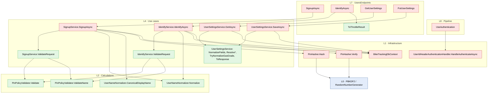

# Backend API Call Graph — Stratified Design

This document maps the call graph of `src/BikeTracking.Api` (and the F# domain it calls in
`src/BikeTracking.Domain.FSharp`) using the **stratified design** technique from
*Grokking Simplicity* (Eric Normand, chapters 8–9).

In stratified design, each function is placed in a layer based on how specific it is.
The top layers hold business-specific flows; the bottom layers hold general-purpose
operations and language/framework features. Arrows point from caller to callee, so in a
healthy design **arrows only point down** and each function calls functions from roughly
the layer directly beneath it.

Each node is also tagged with the *Grokking Simplicity* categories:

| Style | Meaning |
|---|---|
| 🟥 **Action** | Depends on when or how many times it runs: DB, HTTP, file system, clock, SignalR |
| 🟩 **Calculation** | Pure: same input gives the same output, with no side effects |
| 🟦 **Data / platform** | Framework or language primitives the code is built on |

> Generated from the source on 2026-11-05 (commit `06814e7` + local changes). Function
> names match the code. Trivial private helpers and LINQ calls are left out for readability.

---

## 1. The layers

| Layer | Name | What lives here |
|---|---|---|
| **L8** | Composition root | `Program.cs`: DI registration, middleware pipeline, `Map*Endpoints`, migrations at startup |
| **L7** | HTTP handlers | `Endpoints/*Endpoints.cs` static handlers, `ImportProgressHub` |
| **L6** | Import workflows | `CsvRideImportService`, `MonthlySummaryImportService`, `CsvExpenseImportService` |
| **L5** | Background job engine | `ImportJobProcessor` |
| **L4** | Core use cases | Ride, expense, dashboard, export, user and settings services |
| **L3** | Domain lookups and detectors | Weather and gas price lookups, duplicate detection, progress notifier |
| **L2** | Domain calculations | C# `*Rules`, parsers, estimators, event payload factories, and the F# domain modules |
| **L1** | Infrastructure adapters | `BikeTrackingDbContext`, `EfImportJobRepository`, `FileSystemReceiptStorage`, `PinHasher`, auth handler |
| **L0** | Platform | EF Core / SQLite, `IHttpClientFactory`, SignalR, `System.IO`, crypto, `TimeProvider` |

---

## 2. Overview: class-level call graph

```mermaid
flowchart TB
    classDef action fill:#fde2e2,stroke:#c0392b,color:#000
    classDef calc fill:#e3f6e3,stroke:#27ae60,color:#000
    classDef data fill:#e3ecfa,stroke:#2e5c9a,color:#000

    subgraph L8["L8 · Composition root"]
        Program["Program.cs"]
    end

    subgraph L7["L7 · HTTP handlers"]
        UsersEP["UsersEndpoints"]
        RidesEP["RidesEndpoints"]
        ExpensesEP["ExpensesEndpoints"]
        DashboardEP["DashboardEndpoints"]
        ExportEP["ExportEndpoints"]
        ImportEP["ImportEndpoints"]
        MonthlyEP["MonthlyImportEndpoints"]
        ExpImportEP["ExpenseImportEndpoints"]
        Hub["ImportProgressHub"]
    end

    subgraph L6["L6 · Import workflows"]
        CsvRideImport["CsvRideImportService"]
        MonthlyImport["MonthlySummaryImportService"]
        CsvExpImport["CsvExpenseImportService"]
    end

    subgraph L5["L5 · Background job engine"]
        Processor["ImportJobProcessor"]
    end

    subgraph L4["L4 · Core use cases"]
        RecordRide["RecordRideService"]
        EditRide["EditRideService"]
        DeleteRide["DeleteRideService"]
        History["GetRideHistoryService"]
        Presets["RidePresetService"]
        RecordExp["RecordExpenseService"]
        EditExp["EditExpenseService"]
        DeleteExp["DeleteExpenseService"]
        Dash["GetDashboardService"]
        AdvDash["GetAdvancedDashboardService"]
        YearDash["GetYearStatsDashboardService"]
        ExpExport["ExpenseCsvExportService"]
        RideExport["RideHistoryCsvExportService"]
        Signup["SignupService"]
        Identify["IdentifyService"]
        Settings["UserSettingsService"]
    end

    subgraph L3["L3 · Domain lookups and detectors"]
        Weather["OpenMeteoWeatherLookupService"]
        Gas["EiaGasPriceLookupService"]
        DupRes["DuplicateResolutionService"]
        ExpDup["ExpenseDuplicateDetector"]
        Notifier["ImportProgressNotifier"]
    end

    subgraph L2["L2 · Domain calculations"]
        direction LR
        subgraph L2cs["C# rules and parsers"]
            CsvParser["CsvParser"]
            CsvRules["CsvValidationRules"]
            MonthlyParser["MonthlySummaryParser"]
            MonthlyRules["MonthlySummaryValidationRules"]
            ExpParser["CsvExpenseParser"]
            Estimator["ImportProgressEstimator"]
            WeekKey["GasPriceWeekKeyHelper"]
            SavingsRules["SavingsCalculationRules"]
            TimeRules["RidingTimeRules"]
            RowBuilder["CsvRowBuilder"]
            Sample["SampleCsvGenerator"]
            Payloads["Ride*EventPayload.Create"]
            NameNorm["UserNameNormalizer"]
            PinPolicy["PinPolicyValidator"]
            Groups["ImportProgressGroups"]
        end
        subgraph L2fs["F# domain"]
            Wind["WindResistance"]
            AdvCalc["AdvancedDashboardCalculations"]
            Distributor["MonthlySummaryDistributor"]
            ExpEvents["ExpenseEvents"]
        end
    end

    subgraph L1["L1 · Infrastructure adapters"]
        Db["BikeTrackingDbContext"]
        Repo["EfImportJobRepository"]
        Receipts["FileSystemReceiptStorage"]
        Hasher["PinHasher"]
        Coord["GasPriceRefreshCoordinator"]
        AuthH["UserIdHeaderAuthenticationHandler"]
        Boot["SqliteMigrationBootstrapper"]
    end

    subgraph L0["L0 · Platform"]
        EF["EF Core / SQLite"]
        Http["IHttpClientFactory"]
        SignalR["SignalR IHubContext"]
        FS["System.IO"]
        Crypto["System.Security.Cryptography"]
        Clock["TimeProvider"]
    end

    L8 ~~~ L7 ~~~ L6 ~~~ L5 ~~~ L4 ~~~ L3 ~~~ L2 ~~~ L1 ~~~ L0

    %% L8
    Program --> UsersEP & RidesEP & ExpensesEP & DashboardEP & ExportEP & ImportEP & MonthlyEP & ExpImportEP & Hub
    Program --> AuthH
    Program --> Boot

    %% L7 → below
    UsersEP --> Signup & Identify & Settings
    RidesEP --> RecordRide & EditRide & DeleteRide & History & Presets
    RidesEP --> Gas & Weather
    RidesEP --> Sample
    RidesEP -. "layer skip" .-> Db
    ExpensesEP --> RecordExp & EditExp & DeleteExp
    ExpensesEP -. "layer skip" .-> Db
    ExpensesEP -. "layer skip" .-> Receipts
    DashboardEP --> Dash & AdvDash & YearDash
    ExportEP --> ExpExport & RideExport
    ImportEP --> CsvRideImport
    MonthlyEP --> MonthlyImport
    ExpImportEP --> CsvExpImport
    Hub --> Groups

    %% L6
    CsvRideImport --> Processor
    CsvRideImport --> DupRes
    CsvRideImport --> CsvParser & CsvRules & Estimator & Wind
    CsvRideImport --> Repo
    MonthlyImport --> Processor
    MonthlyImport --> MonthlyParser & MonthlyRules & Estimator & Distributor
    MonthlyImport --> Repo
    MonthlyImport -. "layer skip" .-> Db
    CsvExpImport --> RecordExp & EditExp
    CsvExpImport --> ExpDup
    CsvExpImport --> ExpParser
    CsvExpImport -. "layer skip" .-> Db

    %% L5
    Processor --> RecordRide
    Processor --> Gas & Weather & Notifier
    Processor --> Estimator & WeekKey
    Processor --> Repo
    Processor -. "layer skip" .-> Db

    %% L4
    RecordRide --> Weather
    RecordRide --> Wind & Payloads
    RecordRide --> Db
    EditRide --> Weather
    EditRide --> Wind & Payloads
    EditRide --> Db
    DeleteRide --> Payloads
    DeleteRide --> Db
    History --> Db
    Presets --> Db
    RecordExp --> ExpEvents
    RecordExp --> Db & Receipts
    EditExp --> Db
    DeleteExp --> Db & Receipts
    Dash --> SavingsRules & TimeRules
    Dash --> Db
    AdvDash --> SavingsRules & TimeRules & AdvCalc
    AdvDash --> Db
    YearDash --> SavingsRules & TimeRules & AdvCalc
    YearDash --> Db
    ExpExport --> RowBuilder
    ExpExport --> Db
    RideExport --> RowBuilder
    RideExport --> Db
    Signup --> NameNorm & PinPolicy
    Signup --> Hasher & Db
    Identify --> NameNorm & PinPolicy
    Identify --> Hasher & Db
    Settings --> Db

    %% L3
    Weather --> Db & Http & Clock
    Gas --> WeekKey
    Gas --> Db & Coord & Http & Clock
    DupRes --> Db
    ExpDup --> Db
    Notifier --> Groups
    Notifier --> SignalR

    %% L1
    Db --> EF
    Repo --> Db
    Receipts --> FS
    Hasher --> Crypto
    Boot --> EF

    class Program,UsersEP,RidesEP,ExpensesEP,DashboardEP,ExportEP,ImportEP,MonthlyEP,ExpImportEP,Hub action
    class CsvRideImport,MonthlyImport,CsvExpImport,Processor action
    class RecordRide,EditRide,DeleteRide,History,Presets,RecordExp,EditExp,DeleteExp,Dash,AdvDash,YearDash,ExpExport,RideExport,Signup,Identify,Settings action
    class Weather,Gas,DupRes,ExpDup,Notifier action
    class CsvParser,CsvRules,MonthlyParser,MonthlyRules,ExpParser,Estimator,WeekKey,SavingsRules,TimeRules,RowBuilder,Sample,Payloads,NameNorm,PinPolicy,Groups calc
    class Wind,AdvCalc,Distributor,ExpEvents calc
    class Db,Repo,Receipts,Hasher,Coord,AuthH,Boot action
    class EF,Http,SignalR,FS,Crypto,Clock data
```

Dotted arrows marked **layer skip** are the places where a function reaches past the layer
beneath it, which breaks the *straightforward implementation* pattern. See
[§8 Findings](#8-findings).

---

## 3. Rides (function level)

```mermaid
flowchart TB
    classDef action fill:#fde2e2,stroke:#c0392b,color:#000
    classDef calc fill:#e3f6e3,stroke:#27ae60,color:#000
    classDef data fill:#e3ecfa,stroke:#2e5c9a,color:#000

    subgraph H["L7 · RidesEndpoints"]
        PostRecordRide
        PutEditRide
        DeleteRideH["DeleteRide"]
        GetRideHistory
        GetRidePresets
        PostRidePreset
        PutRidePreset
        DeleteRidePreset
        GetGasPrice
        GetRideWeather
        GetCsvSample
        NormalizePresetRequest
        ValidatePresetRequest
        TryResolveRequestedGasGrade
        ResolveSavedGasGradeOrDefault
    end

    subgraph UC["L4 · Ride use cases"]
        RR["RecordRideService.ExecuteAsync"]
        ER["EditRideService.ExecuteAsync"]
        ERV["EditRideService.ValidateRequest"]
        DR["DeleteRideService.ExecuteAsync"]
        GH["GetRideHistoryService.GetRideHistoryAsync"]
        PL["RidePresetService.ListAsync"]
        PC["RidePresetService.CreateAsync"]
        PU["RidePresetService.UpdateAsync"]
        PD["RidePresetService.DeleteAsync"]
        PDto["RidePresetService.ToDto"]
    end

    subgraph LK["L3 · Lookups"]
        WGet["WeatherLookup.GetOrFetchAsync"]
        WRead["TryReadWeatherAtHour"]
        WPrecip["DeterminePrecipitationType"]
        WFail["TryCacheFailure"]
        GGet["GasPriceLookup.GetOrFetchAsync"]
        GFetch["TryFetchLatestPriceAsync"]
        GRead["TryReadPrice"]
        GNorm["TryNormalizeGrade"]
    end

    subgraph DC["L2 · Calculations"]
        TryDir["WindResistance.tryParseCompassDirection"]
        CalcDiff["WindResistance.calculateDifficulty"]
        DirNames["WindResistance.validDirectionNames"]
        RecPay["RideRecordedEventPayload.Create"]
        EdPay["RideEditedEventPayload.Create"]
        DelPay["RideDeletedEventPayload.Create"]
        WeekStart["GasPriceWeekKeyHelper.GetWeekStartDate"]
        SampleGen["SampleCsvGenerator.Generate"]
    end

    subgraph IN["L1 · Infrastructure"]
        Db["BikeTrackingDbContext"]
        Coord["GasPriceRefreshCoordinator.RunExclusiveAsync"]
    end

    subgraph PF["L0 · Platform"]
        Http["HttpClient"]
        Clock["TimeProvider"]
    end

    PostRecordRide --> RR
    PutEditRide --> ER
    DeleteRideH --> DR
    GetRideHistory --> GH
    GetRidePresets --> PL
    PostRidePreset --> NormalizePresetRequest & ValidatePresetRequest & PC
    PutRidePreset --> NormalizePresetRequest & ValidatePresetRequest & PU
    DeleteRidePreset --> PD
    GetGasPrice --> TryResolveRequestedGasGrade & ResolveSavedGasGradeOrDefault & GGet
    GetGasPrice -. "reads UserSettings" .-> Db
    GetRideWeather --> WGet
    GetRideWeather -. "reads UserSettings" .-> Db
    GetCsvSample --> SampleGen

    RR --> TryDir & CalcDiff & DirNames & RecPay & WGet & Db
    ER --> ERV & TryDir & CalcDiff & DirNames & EdPay & WGet & Db
    DR --> DelPay & Db
    GH --> Db
    PL & PC & PU --> PDto
    PL & PC & PU & PD --> Db

    WGet --> WRead & WFail & Db & Http & Clock
    WRead --> WPrecip
    WFail --> Db
    GGet --> GNorm & WeekStart & GFetch & Coord & Db & Clock
    GFetch --> GRead & Http

    class PostRecordRide,PutEditRide,DeleteRideH,GetRideHistory,GetRidePresets,PostRidePreset,PutRidePreset,DeleteRidePreset,GetGasPrice,GetRideWeather,GetCsvSample action
    class NormalizePresetRequest,ValidatePresetRequest,TryResolveRequestedGasGrade,ResolveSavedGasGradeOrDefault calc
    class RR,ER,DR,GH,PL,PC,PU,PD,WGet,WFail,GGet,GFetch,Db,Coord action
    class ERV,PDto,WRead,WPrecip,GRead,GNorm,TryDir,CalcDiff,DirNames,RecPay,EdPay,DelPay,WeekStart,SampleGen calc
    class Http,Clock data
```

---

## 4. Expenses, receipts and expense CSV import (function level)

```mermaid
flowchart TB
    classDef action fill:#fde2e2,stroke:#c0392b,color:#000
    classDef calc fill:#e3f6e3,stroke:#27ae60,color:#000
    classDef data fill:#e3ecfa,stroke:#2e5c9a,color:#000

    subgraph H["L7 · ExpensesEndpoints / ExpenseImportEndpoints"]
        PostExpense
        GetExpenses
        PutExpense
        DeleteExpense
        PutExpenseReceipt
        DeleteExpenseReceipt
        GetExpenseReceipt
        ResolveReceiptContentType
        IsSafeReceiptRelativePath
        EIPreview["PostPreview → PostPreviewCore"]
        EIConfirm["PostConfirm → PostConfirmCore"]
        EIStatus["GetStatus → GetStatusCore"]
        EIDelete["Delete → DeleteCore"]
        ToResult["ToResult / ErrorToResult"]
    end

    subgraph WF["L6 · CsvExpenseImportService"]
        CPrev["PreviewAsync"]
        CConf["ConfirmAsync"]
        CStat["GetStatusAsync"]
        CDel["DeleteAsync"]
    end

    subgraph UC["L4 · Expense use cases"]
        RE["RecordExpenseService.ExecuteAsync"]
        EE["EditExpenseService.ExecuteAsync"]
        EEV["EditExpenseService.ValidateRequest"]
        DE["DeleteExpenseService.ExecuteAsync"]
    end

    subgraph LK["L3 · Detectors"]
        DupMatch["ExpenseDuplicateDetector.GetDuplicateMatchesAsync"]
    end

    subgraph DC["L2 · Calculations"]
        Parse["CsvExpenseParser.Parse"]
        VRow["CsvExpenseParser.ValidateRow"]
        TPA["CsvExpenseParser.TryParseAmount"]
        TPD["CsvExpenseParser.TryParseDate"]
        Ser["ExpenseDuplicateDetector.SerializeExistingExpenseIds"]
        Deser["ExpenseDuplicateDetector.DeserializeExistingExpenseIds"]
        VA["ExpenseEvents.validateAmount (F#)"]
        VD["ExpenseEvents.validateDate (F#)"]
        VN["ExpenseEvents.validateNotes (F#)"]
    end

    subgraph IN["L1 · Infrastructure"]
        Db["BikeTrackingDbContext"]
        RSave["FileSystemReceiptStorage.SaveAsync"]
        RDel["FileSystemReceiptStorage.DeleteAsync"]
        RGet["FileSystemReceiptStorage.GetAsync"]
    end

    FS["System.IO"]

    PostExpense --> RE
    GetExpenses -. "queries directly" .-> Db
    PutExpense --> EE
    DeleteExpense --> DE
    PutExpenseReceipt -. "layer skip" .-> Db & RSave & RDel
    DeleteExpenseReceipt -. "layer skip" .-> Db & RDel
    GetExpenseReceipt --> ResolveReceiptContentType & IsSafeReceiptRelativePath
    GetExpenseReceipt -. "layer skip" .-> Db & RGet

    EIPreview --> CPrev
    EIConfirm --> CConf & ToResult
    EIStatus --> CStat & ToResult
    EIDelete --> CDel

    CPrev --> Parse & VRow & TPA & TPD & DupMatch & Ser
    CPrev -. "layer skip" .-> Db
    CConf --> Deser & RE & EE
    CConf -. "layer skip" .-> Db
    CStat -. "layer skip" .-> Db
    CDel -. "layer skip" .-> Db

    RE --> VA & VD & VN & RSave & Db
    EE --> EEV & Db
    DE --> RDel & Db
    DupMatch --> Db

    RSave & RDel & RGet --> FS

    class PostExpense,GetExpenses,PutExpense,DeleteExpense,PutExpenseReceipt,DeleteExpenseReceipt,GetExpenseReceipt,EIPreview,EIConfirm,EIStatus,EIDelete action
    class ResolveReceiptContentType,IsSafeReceiptRelativePath,ToResult calc
    class CPrev,CConf,CStat,CDel,RE,EE,DE,DupMatch,Db,RSave,RDel,RGet action
    class EEV,Parse,VRow,TPA,TPD,Ser,Deser,VA,VD,VN calc
    class FS data
```

---

## 5. Ride CSV import, monthly summary import and background processing (function level)

```mermaid
flowchart TB
    classDef action fill:#fde2e2,stroke:#c0392b,color:#000
    classDef calc fill:#e3f6e3,stroke:#27ae60,color:#000
    classDef data fill:#e3ecfa,stroke:#2e5c9a,color:#000

    subgraph H["L7 · ImportEndpoints / MonthlyImportEndpoints / Hub"]
        IPrev["Import PostPreview"]
        IStart["Import PostStart"]
        IStat["Import GetStatus"]
        ICancel["Import PostCancel"]
        MPrev["Monthly PostPreview"]
        MStart["Monthly PostStart"]
        MStat["Monthly GetStatus"]
        MCancel["Monthly PostCancel"]
        Sub["Hub.SubscribeToImportJob / Unsubscribe"]
    end

    subgraph WF["L6 · Import workflows"]
        direction LR
        subgraph CRI["CsvRideImportService"]
            CPrev["PreviewAsync"]
            CStart["StartAsync"]
            CStat["GetStatusAsync"]
            CCancel["CancelAsync"]
            CDecode["DecodeCsvText"]
            CBuild["BuildRowData / CreateImportRowEntity"]
            CDup["BuildDuplicateCandidates / ApplyDuplicateMatches"]
            CRes["ResolveDuplicates"]
        end
        subgraph MSI["MonthlySummaryImportService"]
            MSPrev["PreviewAsync"]
            MSStart["StartAsync"]
            MSStat["GetStatusAsync"]
            MSCancel["CancelAsync"]
            MSDecode["DecodeText"]
            MSYears["AssignYears / ValidateYear"]
            MSRes["ResolveDuplicates"]
        end
    end

    subgraph BG["L5 · ImportJobProcessor"]
        Enq["Enqueue"]
        Proc["ProcessAsync"]
        Fail["MarkAsFailedAsync"]
        Pre["PrefetchEnrichmentAsync"]
        LGas["LoadGasLookupAsync"]
        LWx["LoadWeatherLookupAsync"]
        Retry["RetryWithThrottleAsync"]
        Slot["AcquireThrottleSlotAsync"]
        BReq["BuildRecordRideRequest"]
        Grade["ResolveGasGradeOrDefault"]
        Mile["EmitMilestoneNotificationsAsync"]
        Note["CreateProgressNotification"]
    end

    subgraph UC["L4 · Use cases"]
        RR["RecordRideService.ExecuteAsync"]
    end

    subgraph LK["L3 · Lookups and notifications"]
        DupR["DuplicateResolutionService.GetDuplicateMatchesAsync"]
        WGet["WeatherLookup.GetOrFetchAsync"]
        GGet["GasPriceLookup.GetOrFetchAsync"]
        Notify["ImportProgressNotifier.NotifyProgressAsync"]
    end

    subgraph DC["L2 · Calculations"]
        CsvParse["CsvParser.Parse"]
        CsvVal["CsvValidationRules.ValidateRow / TryParse*"]
        Dirs["WindResistance.validDirectionNames"]
        MParse["MonthlySummaryParser.Parse / TryParse*"]
        MVal["MonthlySummaryValidationRules.ValidateRows"]
        Dist["MonthlySummaryDistributor.distributeRides (F#)"]
        Eta["ImportProgressEstimator.CalculateEtaMinutesRounded"]
        Pct["ImportProgressEstimator.CalculatePercentComplete"]
        Miles["ImportProgressEstimator.GetReachedMilestones"]
        Week["GasPriceWeekKeyHelper.GetWeekStartDate"]
        Grp["ImportProgressGroups.RiderJob"]
        HAuth["RiderClaims.TryGetRiderId"]
    end

    subgraph IN["L1 · Infrastructure"]
        Repo["EfImportJobRepository"]
        Db["BikeTrackingDbContext"]
    end

    subgraph PF["L0 · Platform"]
        Scope["IServiceScopeFactory"]
        SR["SignalR IHubContext"]
    end

    IPrev --> CPrev
    IStart --> CStart
    IStat --> CStat
    ICancel --> CCancel
    MPrev --> MSPrev
    MStart --> MSStart
    MStat --> MSStat
    MCancel --> MSCancel
    Sub --> HAuth & Grp

    CPrev --> CDecode & CsvParse & CBuild & CDup & DupR & Repo
    CBuild --> CsvVal & Dirs
    CStart --> CRes & Eta & Enq & Repo
    CStat --> Eta & Pct & Repo
    CCancel --> Repo

    MSPrev --> MSDecode & MParse & MSYears & MVal & Dist & Repo
    MSPrev -. "layer skip" .-> Db
    MSYears --> MParse
    MSStart --> MSRes & Eta & Enq & Repo
    MSStat --> Eta & Pct & Repo
    MSCancel --> Repo

    Enq --> Proc
    Proc --> Scope & Pre & BReq & RR & Mile & Note & Notify & Eta & Fail & Repo
    Proc -. "audit log" .-> Db
    Fail --> Scope & Note & Notify & Repo
    Pre --> Grade & Week & LGas & LWx
    Pre -. "reads UserSettings" .-> Db
    LGas --> Retry & GGet
    LGas -. "reads cache" .-> Db
    LWx --> Slot & Retry & WGet
    LWx -. "reads cache" .-> Db
    Retry --> Slot
    BReq --> Week
    Mile --> Miles & Note & Notify
    Note --> Pct

    DupR --> Db
    Notify --> Grp & SR
    Repo --> Db

    class IPrev,IStart,IStat,ICancel,MPrev,MStart,MStat,MCancel,Sub action
    class CPrev,CStart,CStat,CCancel,MSPrev,MSStart,MSStat,MSCancel action
    class Enq,Proc,Fail,Pre,LGas,LWx,Retry,Slot,Mile,RR,DupR,WGet,GGet,Notify,Repo,Db action
    class CDecode,CBuild,CDup,CRes,MSDecode,MSYears,MSRes,BReq,Grade,Note calc
    class CsvParse,CsvVal,Dirs,MParse,MVal,Dist,Eta,Pct,Miles,Week,Grp,HAuth calc
    class Scope,SR data
```

---

## 6. Dashboards and exports (function level)

```mermaid
flowchart TB
    classDef action fill:#fde2e2,stroke:#c0392b,color:#000
    classDef calc fill:#e3f6e3,stroke:#27ae60,color:#000
    classDef data fill:#e3ecfa,stroke:#2e5c9a,color:#000

    subgraph H["L7 · DashboardEndpoints / ExportEndpoints"]
        GD["GetDashboardAsync"]
        GAD["GetAdvancedDashboardAsync"]
        GYD["GetYearStatsDashboardAsync"]
        GAY["GetAvailableYearsAsync"]
        GEC["GetExpensesCsv"]
        GRZ["GetRideHistoryZip"]
    end

    subgraph UC["L4 · Use cases"]
        D["GetDashboardService.GetAsync"]
        AD["GetAdvancedDashboardService.GetAsync"]
        YD["GetYearStatsDashboardService.GetAsync"]
        YA["GetYearStatsDashboardService.GetAvailableYearsAsync"]
        EX["ExpenseCsvExportService.ExportAsync"]
        RX["RideHistoryCsvExportService.ExportAsync"]
        RXW["RideHistoryCsvExportService.WriteYearCsv"]
    end

    subgraph LOC["L4 private calculations (per service)"]
        DH["Dashboard: CalculateSavings, AggregateSavings,<br/>BuildMileageSeries, BuildSavingsSeries, BuildSuggestions,<br/>CalculateExpenseSummary, GetMonthKey, IsWithinMonth, RoundMoney"]
        ADH["Advanced: BuildWindow, BuildSuggestions,<br/>BuildDifficultySection, GetWindResistanceLabel, RoundTo2"]
        YDH["YearStats: BuildTotalsSection, BuildMileageSeries,<br/>BuildSavingsSeries, BuildDifficultySection,<br/>BuildWindResistanceSection, AggregateSavings,<br/>CalculateExpenseSummary, GetWindResistanceLabel,<br/>GetMonthKey, IsWithinMonth, RoundMoney"]
    end

    subgraph DC["L2 · Calculations"]
        MRS["SavingsCalculationRules.CalculateMileageRateSavings"]
        FCA["SavingsCalculationRules.CalculateFuelCostAvoided"]
        SRM["RidingTimeRules.SumRecordedRideMinutes"]
        CO2["AdvancedDashboardCalculations.calculateCo2Saved (F#)"]
        AVG["AdvancedDashboardCalculations.calculateOverallAverageDifficulty (F#)"]
        BYM["AdvancedDashboardCalculations.calculateDifficultyByMonth (F#)"]
        WRD["AdvancedDashboardCalculations.calculateWindResistanceDistribution (F#)"]
        BH["CsvRowBuilder.BuildHeader"]
        BR["CsvRowBuilder.BuildRow"]
    end

    Db["L1 · BikeTrackingDbContext"]
    Zip["L0 · ZipArchive / MemoryStream"]

    GD --> D
    GAD --> AD
    GYD --> YD
    GAY --> YA
    GEC --> EX
    GRZ --> RX

    D --> DH & SRM & Db
    DH --> MRS & FCA
    AD --> ADH & MRS & FCA & SRM & CO2 & Db
    ADH --> AVG & BYM & WRD
    YD --> YDH & SRM & Db
    YDH --> MRS & FCA & AVG & BYM & WRD
    YA --> Db
    EX --> BH & BR & Db
    RX --> RXW & Zip & Db
    RXW --> BH & BR

    class GD,GAD,GYD,GAY,GEC,GRZ,D,AD,YD,YA,EX,RX,Db action
    class DH,ADH,YDH,RXW,MRS,FCA,SRM,CO2,AVG,BYM,WRD,BH,BR calc
    class Zip data
```

---

## 7. Users, identity and settings (function level)

---

## 8. Findings

Below, the four stratified-design patterns from *Grokking Simplicity* are applied to the
graph above.

### Pattern 1: Straightforward implementation (arrows that skip layers)

A function is easier to read when everything it calls is at about the same level of detail.
These handlers mix high-level service calls with low-level EF Core or file I/O:

| Function | Skips to | Suggestion |
|---|---|---|
| `ExpensesEndpoints.GetExpenses` | `BikeTrackingDbContext` (query + projection in the handler) | Add a `GetExpensesService`, in the same shape as `GetRideHistoryService` |
| `ExpensesEndpoints.PutExpenseReceipt` / `DeleteExpenseReceipt` / `GetExpenseReceipt` | `BikeTrackingDbContext` + `IReceiptStorage` | Add an `ExpenseReceiptService` at L4, next to `RecordExpenseService` |
| `RidesEndpoints.GetGasPrice` / `GetRideWeather` | `BikeTrackingDbContext.UserSettings` | Load the defaults through `UserSettingsService`, or move them into the lookup services |
| `CsvExpenseImportService` (all methods) | `BikeTrackingDbContext.ExpenseImportJobs` | Add an expense-import job repository, matching `IImportJobRepository` for rides |
| `MonthlySummaryImportService.PreviewAsync` | `BikeTrackingDbContext.Rides` | Go through `IDuplicateResolutionService`, as `CsvRideImportService` already does |
| `ImportJobProcessor.PrefetchEnrichmentAsync` / `Load*LookupAsync` | `UserSettings`, `GasPriceLookups`, `WeatherLookups` cache tables | Let the lookup services expose a bulk "get cached" method so the processor stays at L5 |

### Pattern 2: Abstraction barrier

- **`IImportJobRepository` is the only real abstraction barrier over persistence.** The
  ride import services never touch EF Core directly for job state, which is why they are
  easy to unit test.
- **`BikeTrackingDbContext` is injected directly into 25 classes outside the persistence layer (including two endpoint files).** EF Core's
  `DbSet<T>` acts as a de facto barrier, but because LINQ queries are written inline, a
  schema change spreads across every layer from L7 down to L3.
- **`IReceiptStorage`** is a clean barrier. File-system details (`ResolveReceiptsRoot`,
  path safety) stay below it, except that `IsSafeReceiptRelativePath` also lives in
  `ExpensesEndpoints`.

### Pattern 3: Minimal interface

The L2 calculation layer is small and stable, as it should be:

- `WindResistance` (F#) exposes `tryParseCompassDirection`, `calculateDifficulty` and
  `validDirectionNames`. It has four callers across L4 and L6.
- `ImportProgressEstimator` (3 functions) is shared by both import workflows and the
  processor.
- `SavingsCalculationRules` and `RidingTimeRules` are shared by all three dashboard
  services.

The graphs above were drawn before the duplicated helpers below were **moved down a layer**
into shared rules. Each row shows where the copies used to live and where the single
version lives now:

| Helper | Previously duplicated in | Now lives in |
|---|---|---|
| `AggregateSavings`, `RoundMoney` (and `RoundTo2`), `CalculateExpenseSummary`, the 3000-mile oil-change interval | `GetDashboardService`, `GetYearStatsDashboardService`, `GetAdvancedDashboardService` | `SavingsCalculationRules` (L2) |
| `GetMonthKey`, `IsWithinMonth` | `GetDashboardService`, `GetYearStatsDashboardService` | `DashboardMonthRules` (L2) |
| `GetWindResistanceLabel`, the ride to F# `RideDifficultySnapshot` projection (3 copies) | `GetAdvancedDashboardService`, `GetYearStatsDashboardService` | `RideDifficultyRules` (L2) |
| Gas grade normalization (`TryNormalizeGrade`, `TryNormalizeGasGrade`, `NormalizeGasGradeForRead`, `ResolveGasGradeOrDefault`, `ResolveSavedGasGradeOrDefault`) | `EiaGasPriceLookupService`, `UserSettingsService`, `ImportJobProcessor`, `RidesEndpoints` | `GasGradeRules` (L2) |
| CSV parsing (`SplitCsvLine`, `NormalizeHeader`, line splitting) and byte decoding (`DecodeCsvText`, `DecodeText`) | `CsvParser`, `CsvExpenseParser`, `MonthlySummaryParser`, `CsvRideImportService`, `MonthlySummaryImportService` | `ImportText` (L2) |
| `StartAsync`, `GetStatusAsync`, `CancelAsync`, `ResolveDuplicates` | `CsvRideImportService`, `MonthlySummaryImportService` | `ImportJobLifecycle` (between L6 and L5) |
| Rider id claim parsing (`TryGetRiderId`, `FindFirst("sub")`, `ImportProgressHubAuth`) | All 8 endpoint files and `ImportProgressHub` | `RiderClaims.TryGetRiderId` extension (L1, next to the auth handler that writes the claim) |

`BuildDifficultySection` is still written separately in the advanced and year-stats
services because each returns a different contract type. Only their shared snapshot
projection and labels were moved down.

### Pattern 4: Comfortable layers

- **Most stable:** L2 (the F# domain and C# `*Rules`) and L0/L1. These are pure or
  framework-backed, have many callers, and change rarely. Tests here give the most value per
  test.
- **Most volatile:** L7 handlers and L6 workflows. These have the fewest callers (usually one
  route) and are the cheapest places to make changes.
- **Dead code:** `DeleteRideHandler` (L4) is referenced only from
  `DeleteRideHandlerTests`. The live route uses `DeleteRideService`. It sits in the graph
  with no incoming arrows from production code.

### Most-called lower-level functions (highest test value)

| Function | Layer | Production callers |
|---|---|---|
| `BikeTrackingDbContext` | L1 | 25 classes |
| `WeatherLookup.GetOrFetchAsync` | L3 | `RecordRideService`, `EditRideService`, `ImportJobProcessor`, `RidesEndpoints` |
| `WindResistance.validDirectionNames` | L2 | `RecordRideService`, `EditRideService`, `CsvRideImportService`, `CsvValidationRules` |
| `ImportProgressEstimator.*` | L2 | `CsvRideImportService`, `MonthlySummaryImportService`, `ImportJobProcessor` |
| `SavingsCalculationRules.*`, `RidingTimeRules.*` | L2 | All 3 dashboard services |
| `RecordRideService.ExecuteAsync` | L4 | `RidesEndpoints.PostRecordRide`, `ImportJobProcessor.ProcessAsync` |
| `RecordExpenseService` / `EditExpenseService` | L4 | `ExpensesEndpoints`, `CsvExpenseImportService.ConfirmAsync` |
